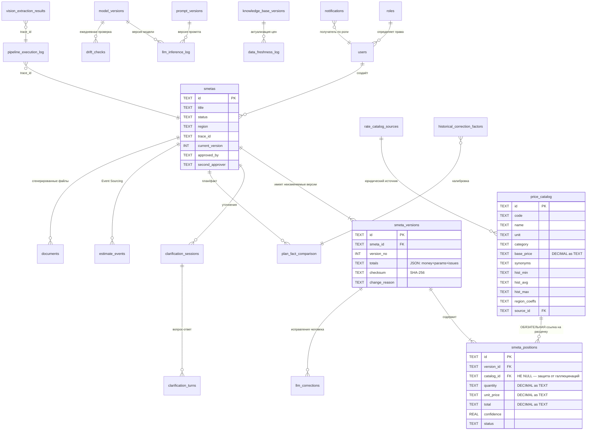

# Приложение Б — Детальная ER-диаграмма базы данных

> Полный DDL: [`src/neuro_smetchik/schema.sql`](../src/neuro_smetchik/schema.sql). В MVP используется SQLite; для прома — PostgreSQL 15+ с `NUMERIC(18,2)`, отдельной схемой `audit` и правами `INSERT-only` для служебной роли.

## 1. Основные связи

## 2. Полный перечень таблиц

| Таблица | Назначение | Ключевые ограничения |
|---|---|---|
| `users`, `roles` | RBAC, MFA | `users.role → roles.role` |
| `smetas` | Метаданные сметы | `current_version` указывает на активную версию |
| `smeta_versions` | Immutable-история | `UNIQUE(smeta_id, version_no)`, триггеры запрета UPDATE/DELETE |
| `smeta_positions` | Позиции версии | `catalog_id NOT NULL REFERENCES price_catalog`, триггеры запрета UPDATE/DELETE |
| `price_catalog` | Справочник расценок | деньги как TEXT/Decimal, исторический диапазон цен, региональные коэффициенты |
| `rate_catalog_sources` | Юридическая прослеживаемость | лицензия, статус проверки, ответственный |
| `clarification_sessions`, `clarification_turns` | Диалог уточнения | `max_turns=5`, `asked_count`, `parsed_json` |
| `llm_corrections` | Исправления человека для обучения | `used_for_training` |
| `golden_examples` | Эталонные запросы | `probe` (эталонная формулировка) + ожидаемые `catalog_id` |
| `plan_fact_comparison` | Сверка план/факт | отклонение в % |
| `historical_correction_factors` | Коэффициенты калибровки | категория, регион, период |
| `pipeline_execution_log` | Журнал шагов/попыток | append-only, `trace_id`, версия промпта/модели |
| `security_audit_log` | Журнал ИБ | append-only + `prev_hash`/`hash` (SHA-256 цепочка) |
| `knowledge_base_versions` | Версии базы знаний | хэш каталога, версии промптов, модель |
| `prompt_versions` | Prompt Version Control | `UNIQUE(service, version)`, статус draft/canary/active/rolled_back |
| `model_versions` | Версии LLM | `weights_hash`, лицензия, точность на golden set |
| `llm_inference_log` | Полный лог вызовов LLM | append-only, `retention_until` ≥12 мес, отдельная схема в проде |
| `vision_extraction_results` | Результаты фото/OCR | качество, confidence, элементы JSON |
| `notifications` | Уведомления | приоритет, канал, `read_at` |
| `documents` | Сгенерированные файлы | формат, путь, автор |
| `drift_checks` | Model Drift Loop | точность, baseline, delta, вердикт |
| `data_freshness_log` | Data Freshness Loop | проверено/обновлено/аномалии |
| `estimate_events` | Event Sourcing | `event_type`, payload, актёр, время |

## 3. Принципы целостности

1. **Никаких FLOAT для денег.** SQLite не имеет `DECIMAL`: значения хранятся строками и всегда преобразуются в `decimal.Decimal`; в PostgreSQL — `NUMERIC(18,2)`.
2. **Версии только добавляются.** Триггеры `BEFORE UPDATE/DELETE` вызывают `RAISE(ABORT, ...)`. Любая правка = новая версия + новая контрольная сумма.
3. **Анти-галлюцинации.** FK `smeta_positions.catalog_id → price_catalog.id` + проверка в Validation Service. Матчер не может создать позицию без существующей расценки.
4. **Воспроизводимость.** Каждый запуск хранит `trace_id`, версии промптов, модель и хэш весов; `llm_inference_log` сохраняет вход/выход каждого вызова.
5. **Неизменяемость аудита.** Хэш строки зависит от предыдущего хэша и нормализованных полей; любая правка ломает цепочку, что проверяется `verify_audit_chain()`.
6. **Разделение прав.** `llm_inference_log` в проде выносится в отдельную схему/БД: доступ только у ML-инженера и безопасности.
