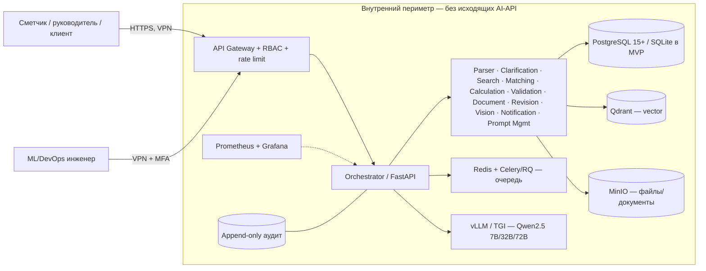
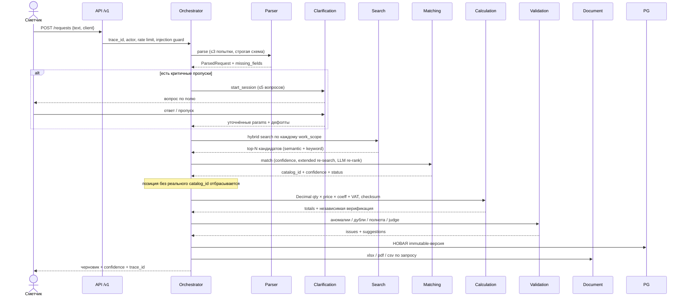
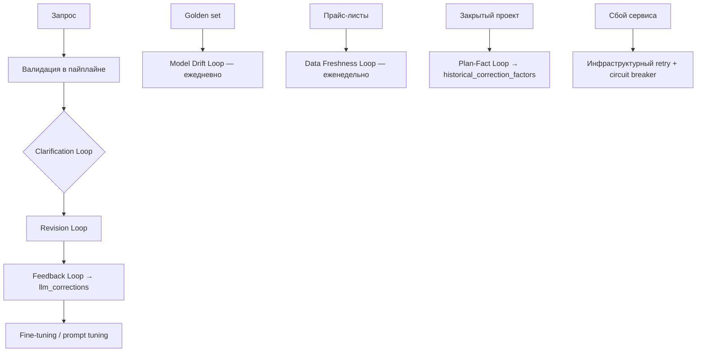

# Архитектура «Нейро-сметчик» (MVP →prod)

## 1. Контекст (C4 Level 1)

**Ключевое ограничение:** стрелки наружу отсутствуют. `LLM_BASE_URL` проверяется на принадлежность списку `LLM_ALLOWED_HOSTS`; любой внешний хост отклоняется, а пайплайн деградирует до детерминированного/ручного режима.

## 2. Пайплайн (детерминированный, без свободных LLM-агентов)

**Circuit breaker:** на шагах `matching`, `calculation`, `validation`, `search`. После 3 сбоев подряд шаг временно отключается, создаётся эскалация и уведомление, пайплайн продолжается в ручном режиме. **Retry:** экспоненциальная задержка 50/100 мс, все попытки пишутся в `pipeline_execution_log`.

## 3. Слои и ответственность

| Слой | Компоненты | Правило |
|---|---|---|
| Presentation | Web UI (vanilla JS), Swagger UI | Confidence-маркировка, diff-view, aria-live, focus-visible |
| API | FastAPI `/api/v1`, Pydantic-схемы | trace_id, RBAC/MFA, rate limit, общий формат ошибок |
| Orchestration | `orchestrator.py` | Фиксированный порядок шагов, retry, эскалация |
| Domain services | 12 сервисов | Чистые функции; деньги только в Calculation |
| Data | PostgreSQL/SQLite, Qdrant, MinIO | DECIMAL, immutable-версии, append-only логи |

## 4. Циклы обратной связи

## 5. Релизный процесс (Dev → Staging → Prod)

Артефакты версионируются **независимо**:

| Артефакт | Источник истины | Проверка перед Staging | Откат |
|---|---|---|---|
| Код | Git, semver | unit + contract + E2E + security | `git revert`, пересборка образа |
| Промпты | `prompt_versions` (БД) | golden set ≥ baseline −2 %, canary 5→25→100 % | `POST /prompts/activate` (без деплоя) |
| Веса модели | `model_versions` + хэш | golden set, лицензия, дрейф-тест | переключение активной версии |
| База знаний | `knowledge_base_versions` + хэш каталога | freshness, покрытие категорий, тестовый поиск | активация предыдущей версии KB |

Error budget ≤1 % технических ошибок: при превышении — заморозка релизов до устранения причин.

## 6. Инфраструктура и изоляция

`docker-compose.yml` в корне — справочный шаблон on-prem-стека (профили `core` и `gpu`): postgres, qdrant, minio, redis, vllm, api, worker, prometheus, grafana. Рекомендации:

* отдельные сети `dmz`, `app`, `data`; только `app` видит `vllm`;
* egress-правило firewall: `DENY` для известных внешних AI-API, `ALLOW` только внутренние репозитории артефактов;
* секреты — Vault / Docker secrets (в репозитории только `.env.example`);
* TLS 1.3 на шлюзе, AES-256 at rest для PostgreSQL/MinIO;
* VPN + MFA для администраторов; append-only аудит выносится в отдельную БД/схему.

## 7. Деградация и отказоустойчивость

| Сбой | Поведение |
|---|---|
| Недоступен vLLM/GPU | `deterministic_fallback` парсера, rule-based matching; уведомление в UI; расчёты и документы продолжают работать |
| Search > SLA | Логируется превышение, возвращаются лучшие кандидаты, позиции уходят на проверку |
| Нет кандидатов в каталоге | Позиция **не создаётся** (защита от галлюцинаций), создаётся эскалация сметчику |
| Несовпадение контрольной суммы | Утверждение заблокировано, ошибка валидации уровня `error` |
| 3 сбоя сервиса | Circuit breaker, эскалация, ручной режим |
| Плохое фото | `degraded_to_manual=true`, ручной ввод параметров |

## 8. Масштабирование

Stateless API масштабируется горизонтально; состояние — в PostgreSQL/Redis; воркеры Celery разбирают очередь; Qdrant шардируется по категориям/филиалам; региональные коэффициенты хранятся в `price_catalog.region_coeffs`; мультитенантность — через `tenant_id` во всех таблицах (точка расширения на этапе 4–5).
